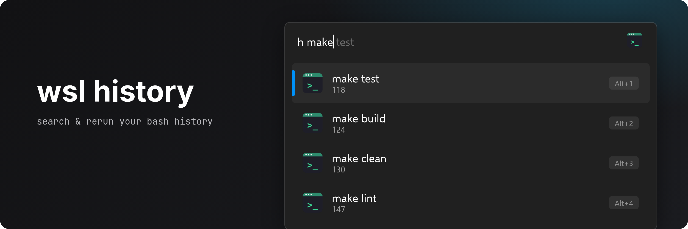

<!-- generated by readwright from docs/README.md.j2; edit the template, not this file -->


# WSL History

Search your WSL bash history from Flow Launcher and run a command again.

[](https://github.com/Garulf/wsl_history/actions/workflows/tests.yml) [](https://github.com/Garulf/wsl_history/releases/latest)

[](https://www.buymeacoffee.com/garulf) [](https://github.com/sponsors/Garulf)

## Usage

Type `h` followed by part of a command you ran in WSL:

```
h git
```


Every line of `~/.bash_history` in your default WSL distribution that contains the text is listed,
oldest first, with its line number underneath. Type just `h` to list the whole history.

Press `Enter` to run the command again. It opens in a new Windows Terminal tab when Windows Terminal
is installed, or in a `cmd` window otherwise, and leaves an interactive bash shell open afterwards.

## Installation

Download `wsl_history-<version>.zip` from the [latest release](https://github.com/Garulf/wsl_history/releases/latest) and unzip it into
`%appdata%\FlowLauncher\Plugins`, then restart Flow Launcher.

Pre-releases of the next version are published from the open release PR on the
[releases page](https://github.com/Garulf/wsl_history/releases) for testing. Flow Launcher won't offer them as updates.

## Requirements

* Windows with WSL and a default distribution that uses bash
* Flow Launcher 1.17.0 or newer
* Python 3.8 or newer, which Flow Launcher can install for you
* [Windows Terminal](https://aka.ms/terminal) (optional)
